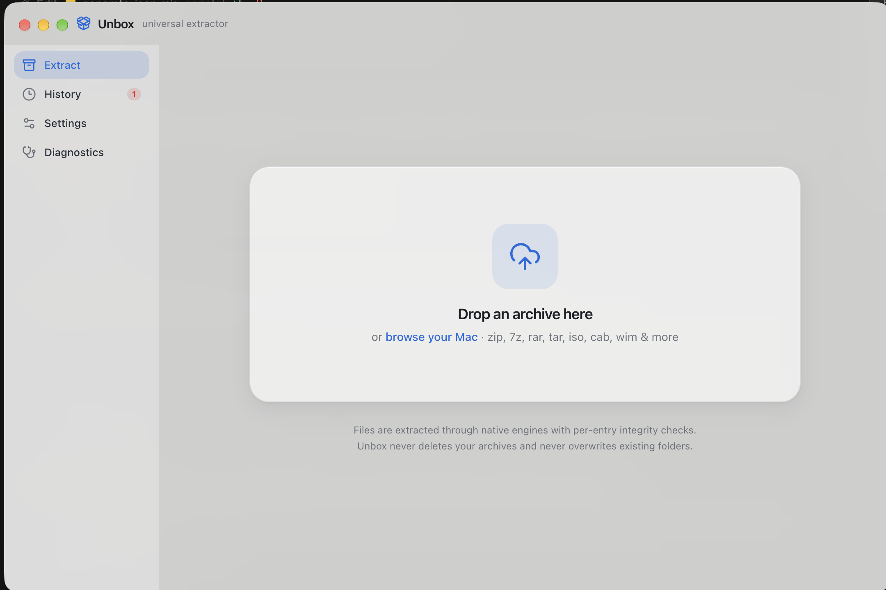
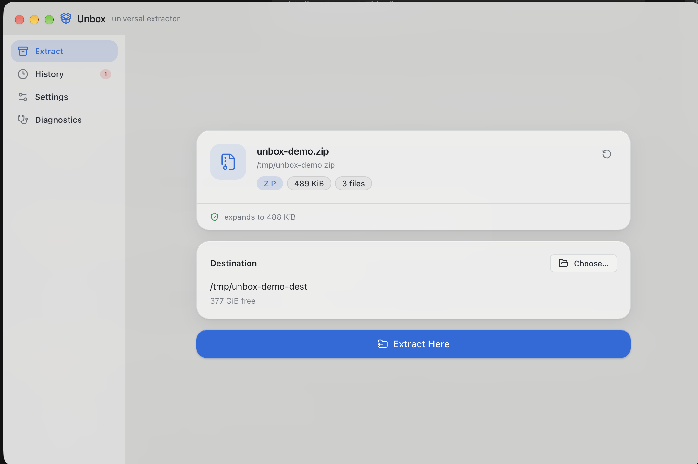
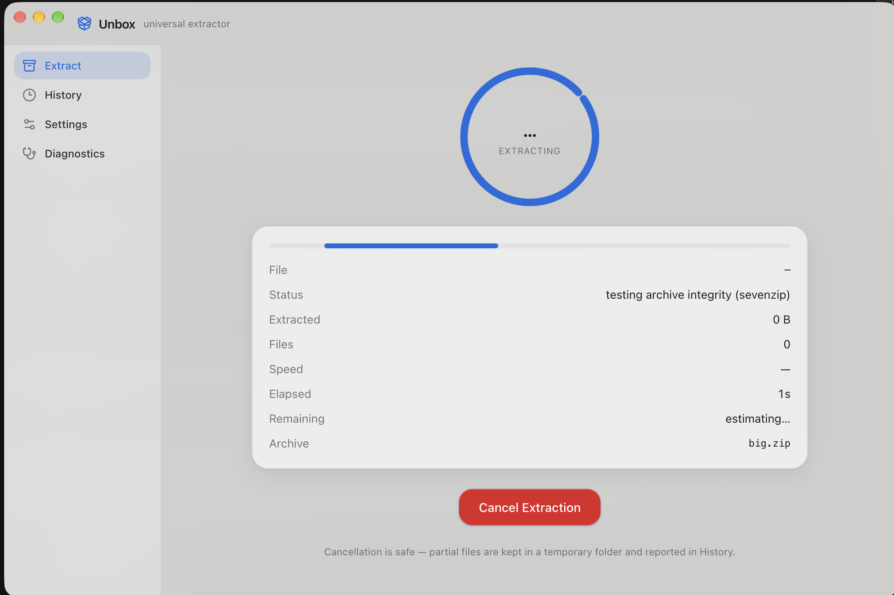
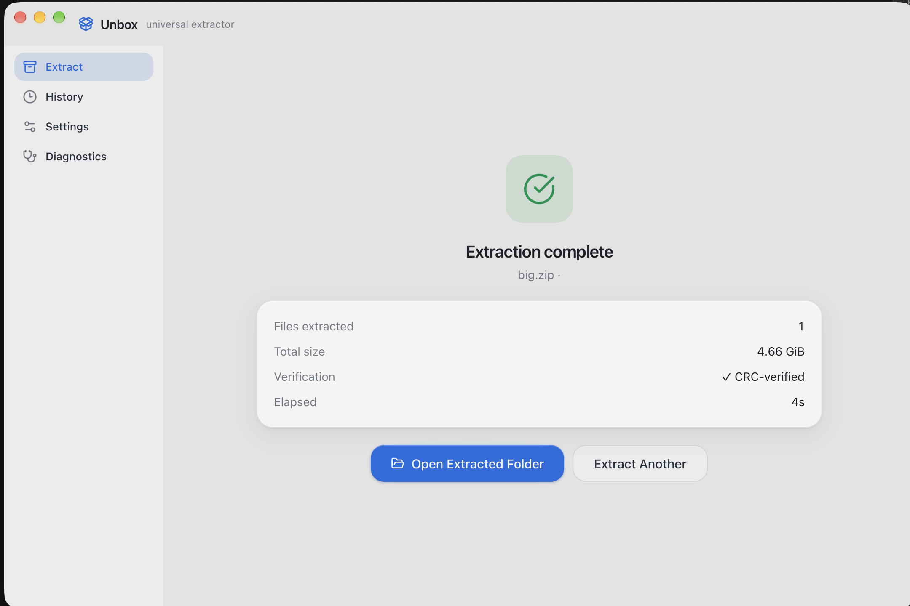
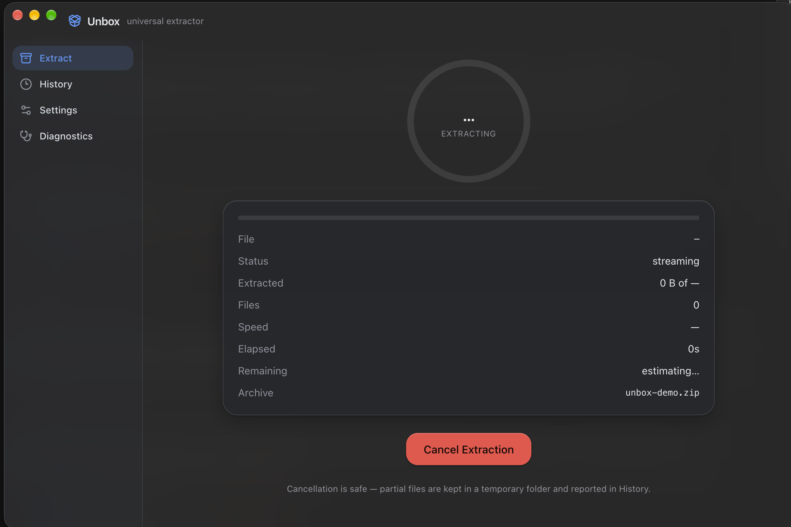
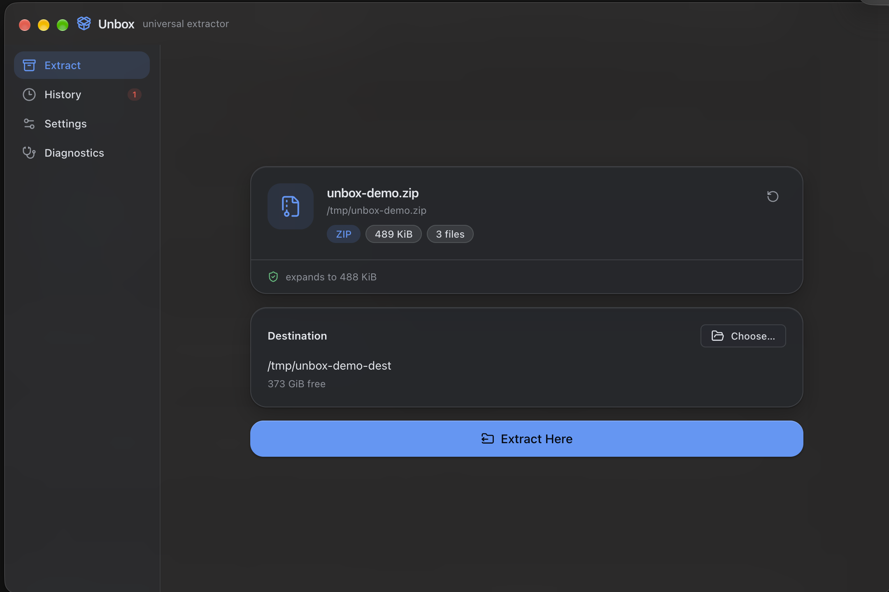

<p align="center">
  
</p>

<h1 align="center">Unbox</h1>

<p align="center">
  <strong>A data-integrity-first archive extractor for macOS.</strong><br />
  From 1&nbsp;GB to 100&nbsp;GB+ — every file verified, nothing silently lost.
</p>

<p align="center">
  <a href="https://github.com/shrey/unbox/releases/latest">
    
  </a>
  <a href="#screenshots">
    
  </a>
</p>

<p align="center">
  
  
  
  
  
  
  
</p>

<p align="center">
  <a href="#download--install">Download</a> ·
  <a href="#screenshots">Screenshots</a> ·
  <a href="#features">Features</a> ·
  <a href="#safety--privacy">Safety</a> ·
  <a href="#build-from-source">Build from source</a> ·
  <a href="#contributing">Contributing</a>
</p>

---

## Screenshots

<p align="center">
  
</p>

<table>
  <tr>
    <td width="50%">
      
    </td>
    <td width="50%">
      
    </td>
  </tr>
  <tr>
    <td width="50%">
      
    </td>
    <td width="50%">
      
    </td>
  </tr>
</table>

<details>
<summary><strong>Dark mode — archive ready to extract</strong></summary>
<br />
<p align="center">
  
</p>
</details>

## Why Unbox?

Extractors are usually judged by how many formats they open. Unbox is judged by
what happens when something goes **wrong** — because with a 50 GB archive, that
is the moment that matters:

- **Verify before writing.** A full engine integrity test runs before a single
  byte touches your disk (for every format that supports one).
- **Never pretend.** The completion report states exactly what was verified —
  per-entry CRC, stream checksums, or size-only — and never upgrades a label
  the format can't earn.
- **Crash-safe by design.** Jobs persist through every state change; a crash
  leaves partial files quarantined in a folder you can inspect or clean from
  History — never mixed into your files and called "done".
- **Your archives stay yours.** Unbox never deletes a source archive, never
  overwrites an existing folder, and refuses malicious entry paths outright.

Under the hood: native engines ([7-Zip](https://www.7-zip.org/),
[libarchive](https://www.libarchive.org/),
[zstd](https://github.com/facebook/zstd)) streaming through sandboxed
workers — no algorithm is reimplemented in JavaScript.

## Features

### Extract
- **Drag and drop** any archive, or browse; format is identified by **magic
  bytes** (extension only as a labeled fallback).
- **24+ formats**: zip, 7z, RAR/RAR5 (extract-only), tar, tar.gz/tgz,
  tar.bz2, tar.xz, tar.zst, gz, bz2, xz, zst, lzma, Z, iso, cab, wim, arj,
  lzh, cpio, xar, msi, rpm, deb, dmg (plain images).
- **Multi-volume**: `.7z.001`, `.zip`/`.z01`, `.rar.part1` — a missing part is
  named in the error, never guessed around.
- **Encrypted archives**: 7z AES-256 (header encryption included), ZipCrypto,
  AES-ZIP, RAR5 — passwords stay in memory, never logged or persisted.
- **Atomic finalization**: extraction lands in a hidden temp workspace and is
  renamed into place only after verification passes — "completed" means
  *completed*.

### Integrity
- **Pre-extraction test** (`7zz t`) for formats that support it, with a live
  "testing archive integrity" phase you can watch (or disable in Settings).
- **In-stream CRC verification** by the engine during extraction; corrupt and
  truncated archives fail loudly with the exact entry named.
- **Post-extract verification**: every listed file checked for presence and
  exact size; symlink/hardlink audit removes and reports anything escaping
  the output folder.
- **Honest verification levels**: `CRC-verified`, `stream checksums`,
  `size-verified`, or `unverified (format limit)` — ISO, LZMA and raw tar
  cannot provide more, and Unbox says so.
- **Disk-space preflight** from real volume stats, with live re-checks during
  extraction of stream formats (measured compression ratio, not a guess).

### Recovery
- **Persisted jobs** — every state transition is written atomically; the UI
  can never show a state ahead of disk.
- **Crash reconciliation** — interrupted jobs are detected at next launch;
  partial files stay in a hidden `.unbox-partial-*` folder you can open or
  clean from **History**.
- **Safe cancellation** — engines get a cooperative abort with a hard-kill
  watchdog; partials are preserved and reported, never silently discarded.
- **Detailed reports** — every engine error line is classified
  (`WRONG_PASSWORD`, `CRC_FAILED`, `TRUNCATED`, `MISSING_VOLUME`,
  `PERMISSION_DENIED`…) and surfaced per entry.

### Performance
- **utilityProcess workers** own the engine processes: a wedged disk or a
  crashed engine cannot take the app down.
- **True streaming** — engines pipe through the worker; measured peak RSS
  stays around 100 MiB on multi-GB extractions (1 GB zip: 0.7 s, ~84 MiB
  peak test-process RSS on Apple silicon).
- **Bounded concurrency** (1–4 jobs) and throttled progress (≤10 IPC
  updates/s) keep the UI and external HDDs happy.
- **Million-entry archives** extract fully; only the *preview listing* is
  capped (500k entries) to bound memory against hostile archives.

### Built for macOS
- **Light Glass and Dark Glass** — native window vibrancy, frosted panels,
  real traffic lights, and full system-appearance tracking.
- Native menu bar with **Extraction ▸ Cancel** (⌘.), Finder hand-off
  (**Open With** / drag onto the dock icon), and **Reveal in Finder**.
- A **Diagnostics** page shows engine versions, exact binary paths, and the
  structured log — support questions answer themselves.
- Sandboxed renderer, `contextIsolation` on, `nodeIntegration` off, a single
  validated IPC surface, and a restrictive CSP.

## Download & install

### Direct download

1. Open **[Releases](https://github.com/shreyzeous21/unbox/releases/latest)** and pick
   the build for your Mac:

   | Your Mac | Download |
   | --- | --- |
   | Apple silicon (M1–M5) | `Unbox-0.1.0-arm64.dmg` |
   | Intel | `Unbox-0.1.0-x64.dmg` |

2. Open the DMG and drag **Unbox** into **Applications**.
3. Drop an archive on the window. That's the whole onboarding.

> **First launch:** builds are currently ad-hoc signed, so macOS may warn that
> Unbox is from an unidentified developer. Right-click **Unbox** → **Open**,
> or clear the quarantine flag:
>
> ```bash
> xattr -dr com.apple.quarantine /Applications/Unbox.app
> ```

### Requirements

- macOS 13 (Ventura) or later
- Apple silicon or Intel
- Enough free disk space for the extracted content — Unbox checks and tells
  you before starting

## Build from source

Requires **Node 20+**, **npm**, and Xcode Command Line Tools (the zstd engine
is built from pinned source).

```bash
git clone https://github.com/shrey/unbox.git
cd unbox
npm install
npm run engines:fetch   # vendor 7zz (SHA-256 pinned) + build universal zstd
npm run dev             # start the app with hot reload
npm run dist            # icon + build + package .dmg + .zip (arm64 + x64)
```

> npm 12 may block package install scripts on first run (`npm warn
> install-scripts`). If `resources/bin` is empty after install, run
> `node scripts/fetch-engines.mjs`.

### Development scripts

| Command | What it does |
| --- | --- |
| `npm run dev` | Run Unbox with hot reload |
| `npm run build` | Production build into `out/` |
| `npm run engines:fetch` | Vendor the native engines (checksum-pinned) |
| `npm run icons` | Regenerate `build/icon.png` + `icon.icns` (dependency-free renderer) |
| `npm run dist` | Icons + build + package DMG/ZIP (arm64 + x64) |
| `npm test` | 48 tests: unit + real-engine integration (SHA-256 round-trips, corruption, passwords, ZIP-slip, cancellation) |
| `npm run test:heavy` | 1 GB + 10 GB + million-entry tests (`EXTRACTOR_HEAVY=1`; `=100` adds 50/100 GB) |
| `npm run typecheck` | Strict TypeScript across main, preload, and renderer |

### What the tests actually prove

- **Byte-exact round-trips**: archives are created with the real engines from
  deterministic source trees and verified against SHA-256 manifests — across
  zip, 7z, tar, tar.gz, tar.bz2, tar.xz, tar.zst, and gz.
- **Failure honesty**: corrupted, truncated, wrong-password, and
  missing-volume archives *fail with the right error*, and partial files are
  never renamed into place.
- **Hostile input**: ZIP-slip traversal entries and control-character names
  abort the job before extraction.
- **End-to-end**: an Electron harness drives full jobs through the real
  main process + utilityProcess worker; a UI harness clicks the real
  **Extract Here** button in the real renderer.
- **Scale**: heavy tests assert exact bytes on disk and peak RSS — large-file
  support is demonstrated, not extrapolated from small-file tests.

## Safety & privacy

- **Read-only outside your choices.** Unbox writes only to the destination
  you picked, inside a temp folder it owns, finalized by atomic rename.
- **Never destroys.** Source archives are never modified (hash-verified in
  tests); existing folders are never overwritten — conflicts resolve to
  `name-1`, `name-2`, … or an explicit ask.
- **Malicious archives are refused, not remapped.** Traversal, absolute
  paths, UNC/drive-letter names, NUL and control characters abort the job
  with a violation report; escaping symlinks are removed and reported.
- **Passwords stay secret.** Held in main-process memory only, never logged,
  never written to disk or history. (Residual limitation: the 7-Zip CLI has
  no stdin password input, so the password is visible in the process table to
  your own user during extraction — documented in
  [docs/ARCHITECTURE.md](docs/ARCHITECTURE.md) §E.)
- **No network.** No telemetry, no accounts, no calls home. Jobs, settings,
  and logs live in `~/Library/Application Support/Unbox/`.
- **Vendored binaries are pinned.** 7zz and zstd are fetched/built with
  SHA-256 verification; their licenses ship in the bundle.

## Keyboard shortcuts

| Keys | Action |
| --- | --- |
| ⌘ O | Open archive… |
| ⌘ ⇧ D | Choose destination… |
| ⌘ . | Cancel extraction |
| ⌘ 1 | Extract |
| ⌘ 2 | History |
| ⌘ 3 | Settings |
| ⌘ 4 | Diagnostics |
| ⌘ , | Settings |
| ⌘ W | Close window |

Drag an archive onto the dock icon or the window to open it instantly.

## Tech stack

| Layer | Choice |
| --- | --- |
| Shell | Electron 45 + electron-vite (utilityProcess workers) |
| UI | React 19 + TypeScript (strict) |
| Styling | Tailwind CSS v4 + shadcn/ui (vendored), native vibrancy |
| State | Zustand |
| Engines | 7-Zip 23.01 (`7zz`), Apple libarchive (`bsdtar`), zstd 1.5.7 |
| Packaging | electron-builder (arm64 + x64) |
| Tests | Vitest — unit, real-engine integration, env-gated heavy suites |

## Project structure

```text
docs/ARCHITECTURE.md     full design doc (§A–G)
scripts/
  fetch-engines.mjs      checksum-pinned engine vendoring + zstd source build
  generate-icon.mjs      dependency-free app icon renderer (PNG + icns)
resources/
  bin/                   vendored engines (gitignored — run engines:fetch)
  licenses/              7-Zip + zstd license texts
src/shared/              types, format capability matrix, IPC contracts
src/main/
  services/engines/      7zz / bsdtar / zstd adapters + output parsers
  services/extraction/   job runner, orchestrator, persistent job store
  services/              archive detection, fs-safety, disk-space, verification, logging
  worker/                utilityProcess extraction worker
  ipc.ts · menu.ts · index.ts
src/preload/             typed contextBridge API — the only renderer surface
src/renderer/src/        React app (pages, glass components, zustand store)
src/main/e2e-harness.ts  headless Electron end-to-end (main + worker)
src/main/ui-e2e.ts       UI-driven end-to-end (real window, real button)
tests/
  unit/                  parsers + path-safety boundary tests
  integration/           real engines against generated fixtures
  heavy/                 1/10/50/100 GB + million-entry (env-gated)
docs/screenshots/        README screenshots
```

## Roadmap

- [x] 24+ formats with honest per-format integrity labels
- [x] Pre-extraction integrity testing + in-stream CRC verification
- [x] Atomic finalization + crash recovery + safe cancellation
- [x] ZIP-slip / symlink-escape / hostile-name refusal
- [x] Light & Dark Glass UI with real engine-driven progress
- [x] Headless + UI-level Electron end-to-end harnesses
- [x] Heavy suites: 1/10/50/100 GB and million-entry verification
- [x] Universal (arm64 + x64) packaging with bundled engines
- [ ] Signed and notarized builds
- [ ] Per-entry selective extraction from the listing view
- [ ] lz4 and zpaq support
- [ ] Extraction to multiple destinations from one drop
- [ ] Finder Quick Look extension for archive previews

## Known limitations

- **RAR is extraction-only** (unRAR license terms); RAR5 solid archives show
  entry-quantized progress.
- **Weak-integrity formats are labeled as such**: tar header checksums are
  best-effort; ISO9660 and raw LZMA/compress streams carry no per-entry
  CRCs — size verification only. The UI says which level you got.
- **zstd needs the vendored engine** — without `resources/bin/zstd`,
  `.zst`/`.tar.zst` are reported unsupported rather than mis-extracted.
- **Listings cap at 500,000 entries** (extraction itself is uncapped —
  million-entry archives extract fully).
- **Stream formats** (tar.gz etc.) have no upfront size: the progress ring is
  indeterminate and tight-disk situations may abort conservatively — by
  design.
- **Password entry is visible in the process table** to your own user during
  extraction (7-Zip CLI limitation — see Safety & privacy).
- **DMG support covers plain images**; encrypted/APFS DMGs are rejected with
  a clear error.
- **Builds are ad-hoc signed, not notarized** — see the first-launch note.

## Contributing

Contributions are welcome — issues, ideas, and pull requests alike.

1. Fork the repo and create a branch: `git checkout -b feat/my-change`
2. Keep the integrity guarantees intact: no silent failures, no faked
   progress, no upgraded verification labels.
3. Run the checks: `npm run typecheck && npm test`
4. Open a pull request describing the problem and the fix.

If you find a security issue, please open a private advisory instead of a
public issue.

## Acknowledgements

Unbox stands on the shoulders of
[7-Zip](https://www.7-zip.org/) by Igor Pavlov,
[libarchive](https://www.libarchive.org/),
[Zstandard](https://github.com/facebook/zstd),
[Electron](https://www.electronjs.org/),
[React](https://react.dev/),
[electron-vite](https://electron-vite.org/),
[Tailwind CSS](https://tailwindcss.com/),
[shadcn/ui](https://ui.shadcn.com/),
[Zustand](https://zustand-demo.pmnd.rs/), and
[Lucide](https://lucide.dev/).

The app icon is generated locally by
[`scripts/generate-icon.mjs`](scripts/generate-icon.mjs) with a
dependency-free PNG encoder.

## License

[MIT](LICENSE) © Shrey
